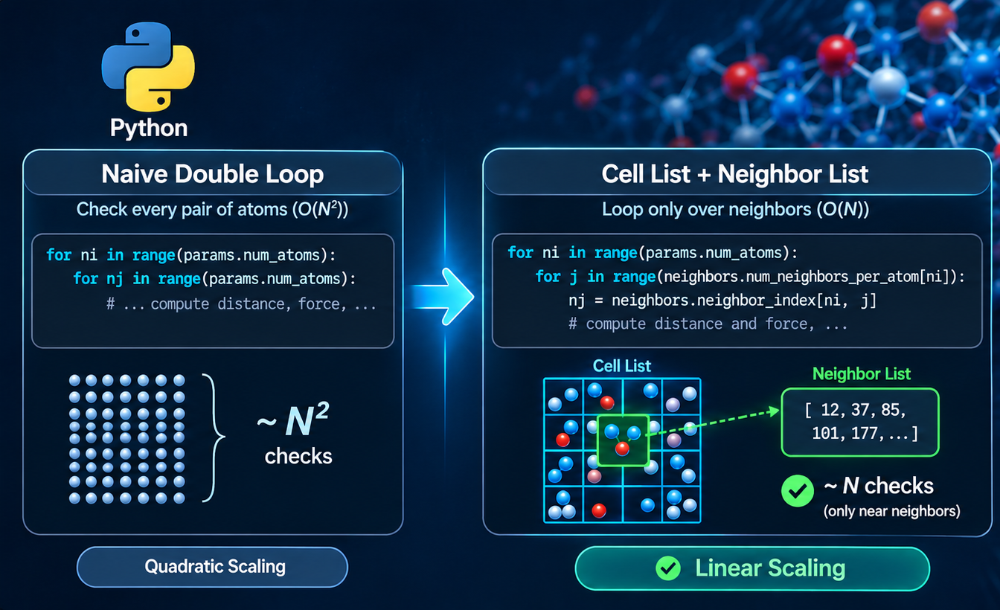

<figure style="width: 100%" class="align-center">
  
  <figcaption> 
  </figcaption>
</figure> 


This post is shows my attempts on implementing a **linear-scaling** molecular dynamics simulator.
The main goal is improve computational complexity using **cell list** and **neighbor list** methods, 
in comparison to my previous [simple MD](https://github.com/hghcomphys/simulational-physics/tree/master/simple_md) implementation. 
These techniques reduce the computational complexity of force calculations from O(N²) to approximately O(N) for short-range interactions, 
where N is the number of atoms in the system.
Also, it showcases that a Python implementation using [Numba](https://numba.pydata.org/) compiler could be an alternative to C++ for scientific computing, 
offering more productive development experience without compromising performance.


<figure style="width: 500px" class="align-center">
  
  <figcaption>
An example MD system with 4000 Argon atoms.
  </figcaption>
</figure> 


## Why linear-scaling MD matters 

A simple implementation of a molecular dynamics (MD) simulator typically exhibits $O(N^2)$ computational complexity, 
where N is the number of atoms in the system. 
This scaling arises because the force acting on each atom must be computed by considering its interaction with every other atom. 
Consequently, the total number of pairwise interactions grows quadratically with system size, 
making simulations of more than roughly 10,000 atoms impractical, for instance, on a typical desktop computer.
However, many real-world biomolecular and materials science applications require significantly larger systems. 
For example, protein-ligand simulations in water typically contain between 20,000 and 100,000 atoms, 
while large protein complexes may require hundreds of thousands to several million atoms. 
In materials science, nanoparticle simulations often involve 100,000 to 1 million atoms, 
and crack propagation studies in metals may require millions of atoms to accurately capture the underlying physical processes.
For such large systems, the majority of the computational cost is spent evaluating pairwise interactions. 
This process involves three main steps: identifying neighboring atoms, computing interatomic distances, and calculating the resulting forces.

A common strategy for reducing this cost is to introduce a **cutoff radius**. 
Interactions between atoms separated by distances greater than the cutoff are neglected when computing forces. 
This approximation is particularly effective for short-range interactions, whose magnitude decreases rapidly with distance. 
The *Lennard-Jones* potential is a classic example of a short-range interaction that can be efficiently truncated using a cutoff without significantly affecting simulation accuracy.
While a cutoff reduces the number of force evaluations, it does not by itself solve the problem of identifying neighboring atoms. 
A naive neighbor-search algorithm still requires comparing every atom against every other atom at each simulation step, resulting in an O(N²) search cost. 
For large systems, this neighbor-finding process can become just as expensive as the force calculations themselves.
To address this challenge, molecular dynamics packages use data structures such as cell lists and neighbor lists. 
Cell lists partition the simulation domain into small spatial regions, allowing atoms to search for neighbors only within nearby cells. 
Verlet lists store a precomputed list of neighbors within a specified distance and update this list only periodically rather than at every timestep. 
Together, these techniques reduce the cost of neighbor searching from O(N²) to approximately O(N) in practice, 
enabling efficient simulations of systems containing hundreds of thousands or even millions of atoms.

In what follows, I will discuss cell list and neighbor list techniques, why they improve performance, 
and how their combination forms the foundation of efficient modern molecular dynamics simulations.


ADD_MD_FLOWCHART


## Neighbor search methodology

### *Cell List* 

A cell list (also called a *linked-cell list*) is a spatial partitioning data structure used in molecular dynamics (MD) simulations to accelerate neighbor searching. 
Instead of checking every atom against every other atom, the simulation box is divided into small 3D cells, and atoms are assigned to cells based on their positions.

Suppose we have N=100,000 atoms.
A naive neighbor search would require N(N-1)/2 pair wise distance which mean $5 \times 10^9$ comparisons per timestep.
Most of these comparison are wasted because the majority of atom paris are much further apart than the cutoff radius and thefore do no interact.
Cell list eliminates these unnecessary checks.

An alternative to cell lists is the use of general-purpose spatial trees, such as *k-d trees*. 
These data structures recursively partition space into hierarchical regions, allowing nearby particles to be located without scanning the entire system.
For systems with approximately uniform density, their O(N logN) scaling is typically slower of cell list method.


<figure style="width: 50%" class="align-center">
  
  <figcaption>
  Illustration of cell list algorithm.
  </figcaption>
</figure> 


### *Neighbor list* 

Neighbor list (also called *Verlet list*) is a data structure that stores, for each atom, the set of nearby atoms that could potentially interact with it. 

Cell list are often not used directly for force calculations.
A cell list helps to find atoms near to specific atom however rebuilding this information every time step still cost time. 
As atoms move only a very small distance during a single MD timestep (typically 1-2 fs). 
Therefore, the set of neighbors changes slowly.
Instead of searching for neighbors at every timestep, the neighbor list is built once and reused for many timesteps.
Rebuilding the list when atoms have moved too much.


<figure style="width: 70%" class="align-center">
  
  <figcaption>
  Illustration of neighbor list algorithm.
  </figcaption>
</figure> 


## Python implementation 

I use **Numba** to JIT-compile performance critical parts of the code, 
enabling near-native execution speed while maintaining a high-level and readable codebase.


### Initialization 

```python

```

### Cell list


```python

```

## Neighbor list 


```python

```


## Simulation


```python

```


## Comparing performance to C++ 


## Performance analysis


### Hardware-level profiling

You can collect hardware performance counters using `perf`:

```bash
perf stat -e cycles,instructions,cache-references,cache-misses python md.py
```


#### C++ 

Below are profiling results for a simulation with 4000 atoms and 1000 time steps:

```text
 Performance counter stats for './md.x':

    19.647.672.034      cycles
    35.184.297.731      instructions              #    1.79  insn per cycle
       476.082.499      cache-references
        79.637.529      cache-misses              #   16.7% of all cache refs

       4.93 seconds time elapsed

       4.93 seconds user
       0.00 seconds sys
```

#### Numba-JIT

Profiling results for 4000 atoms and 1000 time steps:

```text
 Performance counter stats for 'python md.py':

    34.785.338.573      cycles
    52.160.003.366      instructions              #    1.50  insn per cycle
       600.427.540      cache-references
       141.996.840      cache-misses              #   23.6% of all cache refs

       8.26 seconds time elapsed

       9.02 seconds user
       0.10 seconds sys
```

Python with Numba achieves comparable scaling, with only a moderate (~1.7×) performance penalty.


### Scalane profiling

For Python-level performance analysis, the `scalene` profiler can be used:

```bash
scalene python md.py
```

This provides detailed insights into CPU, memory, and Python vs. native execution time.


## Results 

### Linear scaling behavior (*O(N)*)

The below figure shows the execution time of a Lennard–Jones MD simulation as a function of the number of atoms, for system sizes ranging from 4,000 up to 1 million atoms, executed on a laptop. Each data point corresponds to 1000 MD time steps.

<figure style="width: 70%" class="align-center">
  
  <figcaption>
  Linear-scaling of same MD code implemented in C++ and Python Numba.
  </figcaption>
</figure> 


Both the C++ and Python (Numba) implementations exhibit a clear **linear scaling** behavior, demonstrating that the use of cell lists and neighbor lists effectively reduces the computational complexity of force evaluations to approximately *O(N)* for short-range interactions. The near-straight lines indicate that the per-atom computational cost remains approximately constant as the system size increases.


### Performance comparison between C++ and Python (Numba)

The C++ implementation consistently achieves lower execution times, as expected, while the Python (Numba) implementation follows the same trend with only a moderate performance overhead. 
This notably highlights Numba’s competitive performance, alternative to C++, for large-scale MD simulations.

<figure style="width: 70%" class="align-center">
  
  <figcaption>
  Linear-scaling of same MD code implemented in C++ and Python Numba.
  </figcaption>
Performance comparison between C++ and Python (Numba)
</figure> 


<!-- 
#### Memory

For large systems, both implementations exhibit similar memory usage.
For smaller systems, the Python implementation requires more memory. 
-->


