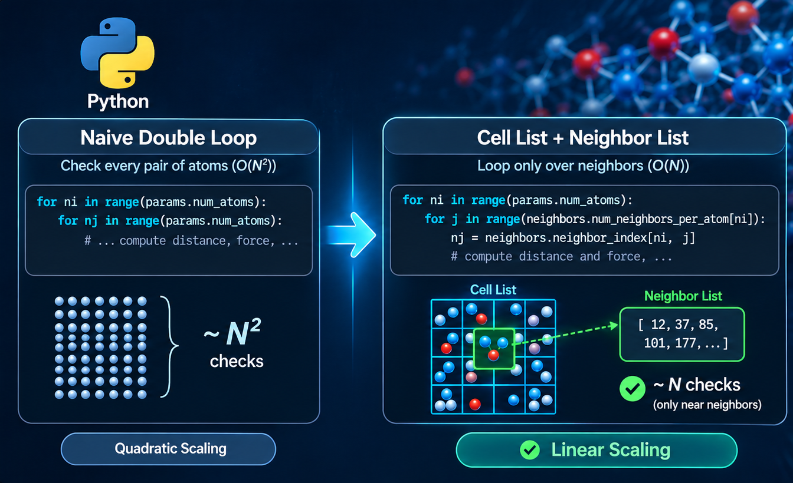
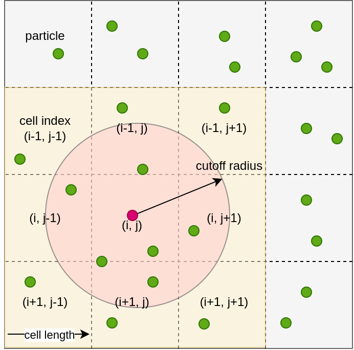

<figure style="width: 100%" class="align-center">
  
  <figcaption> 
  </figcaption>
</figure> 

This post will attempt to show how to implement a **linear-scaling** molecular dynamics (MD) simulator.
The main goal is to improve the computational complexity using **cell-list** and **neighbor-list** methods, 
in comparison to my [simple MD](https://github.com/hghcomphys/simulational-physics/tree/master/simple_md) implementation. 
These methods have been shown reducing the computational complexity of force calculations from O(N²) to approximately O(N) for short-range interactions, 
where N is the number of atoms in the system.
The secondary goal is to showcase that a Python implementation using [Numba](https://numba.pydata.org/) compiler could be an alternative to C++ for scientific computing, in my opinion, offering a productive development experience without compromising much of performance.
For this, I will simulate particles in a simulation box and compute their trajectories over time.

Let's get started!

<!-- {: .notice--info}
The Jupyter notebook containing the example codes from this post is available [here](https://github.com/hghcomphys/linear-md/blob/post/post.ipynb) -->

## Importance of linear-scaling MD 

A simple MD implementation typically results in O(N²) computational complexity.
This scaling arises because force acting on each atom must be computed by considering its interaction with every other atom. 
The total number of pairwise interactions consequently grows **quadratically** with the number of atoms, 
making simulations of more than roughly 10,000 atoms challenging and even impractical.
However, many real-world biomolecular and materials science applications require significantly larger systems. 
For example, protein-ligand simulations in water typically contain between 20,000 and 100,000 atoms, 
while large protein complexes may require hundreds of thousands to several million atoms. 
In materials science, nanoparticle simulations often involve 100,000 to 1 million atoms, 
and crack propagation studies in metals may require millions of atoms to accurately capture the underlying physical processes.
For such large systems, the majority of the computational cost is spent evaluating interactions. 
This process involves three main steps: identifying neighboring atoms, computing interatomic distances, and calculating the resulting forces.

A common approach for reducing this cost is to introduce a **cutoff radius**. 
Interactions between atoms separated by distances greater than the cutoff are neglected when computing forces. 
This approximation is particularly effective for short-range interactions, whose magnitude decreases rapidly with distance. 
The *Lennard-Jones* potential is a classic example of a short-range interaction that can be efficiently truncated using a cutoff without significantly affecting simulation accuracy.
While a cutoff reduces the number of force evaluations, it still does not by itself solve the problem of identifying neighboring atoms. 
A naive neighbor-search algorithm still requires comparing every atom against every other atom at each simulation step, resulting in an O(N²) search cost. 
For large systems, this search can become just as expensive as the force calculations themselves.

<!-- ADD_MD_FLOWCHART_WITH_NEIGHBORS -->

## Neighbor-search algorithms

Several algorithms have been separately introduced to overcome the quadratic computational cost 
and most modern MD packages use combination of cell-list and neighbor-list methods for rapidly finding neighbors.
Together, these methods reduce the cost of neighbor searching from O(N²) to approximately O(N) in practice, 
which enable simulations of systems containing hundreds of thousands or even millions of atoms.
An alternative to cell-list is the use of general-purpose spatial trees, such as **KD-Tree search**. 
These methods recursively partition space into hierarchical regions and allowing nearby particles to be located without scanning the entire system.
For systems with approximately uniform density, their O(N logN) scaling is typically slower of the cell-list.

In what follows, I will focus on cell-list and neighbor-list core concepts 
showing how their combination forms the foundation of efficient modern MD simulations.

### Cell-List method 

A cell list **partitions** the simulation box into small spatial regions.
This allows atoms to search for neighbors only within nearby cells instead of the entire simulation box. 
Suppose we have N=100,000 atoms.
A naive neighbor search would require N(N-1)/2 pair wise distance which mean $5 \times 10^9$ comparisons per timestep.
Most of these comparison are wasted because the majority of atom pairs are much further apart than the cutoff radius and therefore do no interact.
Utilizing cell-list eliminates these unnecessary checks.
<!-- Atoms are assigned to cells based on their positions. -->

Figure below shows an illustration of particles in a simulation box (2D) where regions are partitioned in each dimension.

<figure style="width: 50%" class="align-center">
  
  <figcaption>
  Cell-list method for 2D simulation box.
  </figcaption>
</figure> 

The **cell length** must be greater than or equal to the **cutoff radius** to ensure that all neighboring particles can be found by examining only a limited set of nearby cells. 
Each cell is identified by zero-based indices (i, j).
Neighbor cells can be accessed via shifting indices in each direction by 1 including (i+1, j), (i-1, j), (i+1, j-1), (i-1, j-1), (i+1, j+1), and (i-1, j+1).
For cells located near the boundaries of the simulation box, periodic boundary conditions can be applied to ensure that atoms interact correctly across opposite sides of the domain. As a result, atoms near one boundary can identify neighboring atoms located near the corresponding boundary on the opposite side of the simulation box.
Neighbor searching is performed by examining the atoms in the same cell and in the adjacent cells. 
This significantly reduces the number of distance calculations compared to a brute-force search over all atom.

Each cell stores the number of atoms it contains and a list of the corresponding atom indices. 
Atoms are assigned to cells according to their positions within the simulation box which is partitioned in space.

## Neighbor-list method

Cell list is often not used directly for force calculations.
It only helps to find atoms near to specific atom however rebuilding this information every time step still cost time. 
Neighbor list (also known as *Verlet list*) stores a **precomputed** list of neighbors within a specified cutoff distance and update this list only when is needed rather than at every timestep. 
Each item in neighbor list is a data structure that stores, for each atom, the set of nearby atoms that could potentially interact with it. 

As atoms move only a very small distance during a single MD timestep (typically 1-2 fs). 
Therefore, the set of neighbors changes slowly.
Instead of searching for neighbors at every timestep, the neighbor list is built once and reused for many timesteps.
Rebuilding the list when needed as atoms have moved too much.

<!-- <figure style="width: 70%" class="align-center">
  
  <figcaption>
  Neighbor-list method.
  </figcaption>
</figure>  -->

There are several methods for storing atom indices in a neighbor list. 
A simple approach, which is used here, is to preallocate a two-dimensional array whose size is determined by the number of atoms and the maximum expected number of neighbors per atom. 
In addition, a separate array is maintained to store the actual number of neighbors associated with each atom. 
An alternative approach is to use a linked list, where neighbor entries can be inserted or removed dynamically as atoms move. 
This method eliminates the need to allocate extra memory, potentially reducing memory usage. However, linked lists generally provide less efficient memory access patterns and can be slower than array-based neighbor lists due to poor cache utilization. 
Preallocated arrays are often preferred in molecular dynamics simulations when an upper bound on the number of neighbors can be reasonably estimated.
Once the neighbor list has been constructed, force calculations can be performed efficiently by looping over the stored neighbor indices for each atom based. 

The neighbor list is reused for multiple timesteps and rebuilt only when atoms move sufficiently.
The neighbor list cutoff is defined as:

$$
r_{\text{cutoff}} + r_{\text{skin}}
$$

As the first term is the force cutoff and the second term is extra **buffer** distance known as *skin*.
The neighbor list must eventually be rebuilt because atoms continue moving. 
A common criterion is 

$$
\Delta r_{\text{max}} > r_{\text{skin}} /2
$$

Where, $\Delta r_{\text{max}}$ is the maximum displacement of any atom since the last rebuild. 
The rationale is that the neighbor list contains all particles within cutoff distance of each particle. 
Once a particle moves by more than half the skin distance, previously non-neighboring particles could enter the interaction range, making the current neighbor list potentially incomplete.

Now that we have covered the basic concepts of cell and neighbor lists, Let's proceed with the implementation.

## Python implementation  

Here in this section, I'll step by step implement different components require to build a MD simulator and the focus will be on neighbor search algorithm.
I'll use **Numba** to JIT-compile performance critical parts of the code, enabling near-native execution speed while maintaining a high-level and readable implementation in Python.

### Initialization

First of all, we import the basic imports, type alias, and physical constants for our molecular simulation. 
I'll use [ASE](https://ase-lib.org/) to create atomic structures and initialize atomic velocities, avoiding the need to reimplement standard utilities which are not directly related to our discussion. 


```python
import math
from typing import NamedTuple, TextIO

import numpy as np
from numba import njit
from numpy.typing import NDArray
from ase.io import read
from ase.build import bulk
from ase.md.velocitydistribution import (
    MaxwellBoltzmannDistribution,
    Stationary,
)
```

We set floating point precision and memory-layout to `float64` and `C-order` arrays. 
Also defining physical constants including the Boltzmann constant (`K_B`) and a time-unit conversion factor (`FS_TO_NATURAL`).


```python
FLOAT = np.float64
Array = NDArray[FLOAT]
ORDER = "C"

K_B = 8.617343e-5  # eV/K 
FS_TO_NATURAL = 1.0 / 1.018051e1  
```

We will create a 8×8×8 FCC Argon crystal, 
This assigns Maxwell-Boltzmann velocities corresponding to 60 Kelvin temperature and removes any net *center-of-mass* motion so the system starts in thermal equilibrium without overall drift.


```python
ATOMIC_MASS = {"Ar": 40.0}  # amu
atoms_ase = bulk("Ar", "fcc", a=5.385, cubic=True).repeat((8, 8, 8))
MaxwellBoltzmannDistribution(
    atoms_ase,
    temperature_K=60.0,
    rng=np.random.default_rng(1234),
)
Stationary(atoms_ase)
```

The `atoms_ase` is an *Atoms object* in ASE, the main data structure to represent an atomic system including positions, velocities, cell, etc.
Alternatively, we could read positions and box sizes from an input XYZ file:

```python
filename = "argon.xyz" 
atoms_ase = read(filename)
with open(filename) as f:
    f.readline()
    box = np.fromstring(f.readline(), sep=" ").reshape(3, 3)
atoms_ase.set_cell(box)
atoms_ase.set_pbc(True)
```

<figure style="width: 50%" class="align-center">
  
  <figcaption>
Illustration of 4000 atoms in a simulation box.
  </figcaption>
</figure> 

<!-- ADD_REF_TO_GENERATE_LATTICE -->

### Setting simulation parameters

We define here a named tuple to keep our required **parameters** for the simulation. 


```python
class Parameters(NamedTuple):
    num_atoms: int
    time_step: float
    temperature: float
    cutoff_radius: float
    skin_radius: float
    neighbor_max_atoms: int
```

`Parameters` include the number of atoms, time step, temperature, interaction cutoff radius, neighbor-list skin distance, and the maximum number of neighbors per atom.


```python
params = Parameters(
    num_atoms=len(atoms_ase),
    time_step=0.5 * FS_TO_NATURAL,
    temperature=60.0, # Kelvin
    cutoff_radius=9.0,  # Angstrom
    skin_radius=1.0,  # Angstrom
    neighbor_max_atoms=500,
)
params
```

Output

```text
Parameters(num_atoms=2048, time_step=0.04911345305883497, temperature=60.0, cutoff_radius=9.0, skin_radius=1.0, neighbor_max_atoms=500)
```

### Defining particles

We also define **particles**, which are our internal representation of the atoms in the simulation box. 
A particle stores the state needed during molecular dynamics including mass, position, velocity, force, simulation box, and previous positions. 
For performance reasons, the data is stored as a **Structure of Arrays (SoA)**, where each property is kept in a separate contiguous array, improving memory locality and enabling more efficient Numba computations.


```python
class Particles(NamedTuple):
    mass: Array
    position: Array
    velocity: Array
    force: Array
    box: Array
    position_old: Array
```

We represent particles as a `NamedTuple` because it can be passed directly as an argument to Numba JIT-compiled functions, while still providing a clear and convenient way to access particle properties. 
Next, the particle's arrays are initialized from the ASE system by extracting masses, positions, velocities, and box information, allocating storage for forces, and creating a copy of the initial positions as follows:


```python
mass = atoms_ase.get_masses()
position = np.asarray(atoms_ase.get_positions(), dtype=FLOAT, order=ORDER)
velocity = np.asarray(atoms_ase.get_velocities(), dtype=FLOAT, order=ORDER)
force = np.empty((len(atoms_ase), 3), dtype=FLOAT, order=ORDER)
box =  np.asarray(atoms_ase.cell.array, dtype=FLOAT)
particles = Particles(
    mass=mass,
    position=position,
    velocity=velocity,
    force=force,
    box=box,
    position_old=position.copy(),
)
# particles
```

The `position_old` array is an auxiliary array used to store the atomic positions at the time of the last neighbor list update. 
It will later be used to determine when atoms have moved sufficiently to require rebuilding the neighbor list, which I will discuss when implementing the neighbor-list update routines.

### Initializing neighbors 

A simple force calculation would directly loop over all atom pairs (i and j) and evaluate the pairwise interaction to compute the forces acting on each atom. 
While straightforward, this approach introduces an O(N²) computational complexity, making force evaluation the main performance bottleneck for large systems.
This is precisely where cell and neighbor lists become essential. 
These data structures reduce the number of pairwise distance evaluations and improve scalability by restricting force calculations to atoms that are spatially close enough to interact,

I'll first discuss initializing the cell and neighbor data structures. 
Then, I'll cover how these structures are updated as the simulation progresses and atomic positions evolve over time.

#### Cell-list

We define again `CellList` as a named tuple as follows: 


```python
class CellList(NamedTuple):
    num_atoms_per_cell: NDArray
    atom_index: NDArray
    sizes: tuple[int, int, int]
```

For each cell, it stores the number of atoms assigned to the cell (`num_atoms_per_cell`) and the indices of those atoms (`atom_index`). 
The sizes field contains the number of cells along each box dimension. 
This structure allows identification of nearby atoms by searching only neighboring cells instead of the entire system.

<!-- ADD_DIAGRAM_? -->

Function below initializes `CellList` data structure based on given atom positions and simulation box dimension.


```python
def initialize_cell_list(
    params: Parameters,
    box: Array,
):
    cell_length = params.cutoff_radius
    length = box[0][0], box[1][1], box[2][2]
    cell_sizes = (
        int(length[0] / cell_length),
        int(length[1] / cell_length),
        int(length[2] / cell_length),
    )
    for size in cell_sizes:
        assert size > 2, print(f"{cell_sizes=}")

    system_volume = math.prod(length)
    cell_volume = cell_length**3
    cell_max_atoms = 3 * int(params.num_atoms / system_volume * cell_volume)
    print("Cell max atoms:", cell_max_atoms)

    cell_atom_index = np.empty(
        shape=(math.prod(cell_sizes), cell_max_atoms),
        dtype=np.int32,
    )
    cell_num_atoms = np.empty(
        math.prod(cell_sizes),
        dtype=np.int32,
    )
    
    return CellList(
        sizes=cell_sizes,
        num_atoms_per_cell=cell_num_atoms,
        atom_index=cell_atom_index,
    )
```

The simulation box is divided into a regular 3D grid of cells whose side length is chosen to be equal to (or greater than) the cutoff radius. 
The number of cells along each dimension is computed from the box size, and a sanity check ensures that there are at least three cells in every direction.
An upper bound on the number of atoms per cell (`cell_max_atoms`) is estimated from the system density and cell volume, with an additional safety factor to accommodate density fluctuations during the simulation.

The function then allocates:

- `cell_num_atoms`: the current number of atoms in each cell.
- `cell_atom_index`: the indices of atoms assigned to each cell.
- `sizes`: the number of cells along the x, y, and z directions.

Finally, these arrays are packaged into a `CellList` object and returned. 
<!-- At this stage, the data structures are only allocated; the assignment of atoms to cells is performed later when the cell-list is built or updated. -->

#### Neighbor list

Similarly, we define `NeighborList` as follows:


```python
class NeighborList(NamedTuple):
    num_neighbors_per_atom: NDArray
    neighbor_index: NDArray
```

A `NeighborList` stores the set of nearby atoms that lie within the cutoff. 
`num_neighbors_per_atom` records how many neighbors each atom has, while `neighbor_index` contains the corresponding neighbor indices. 
During force evaluation, interactions are computed only with these precomputed neighbors, reducing the cost from O(N²) to approximately O(N) for typical molecular dynamics systems.

Function below initializes the `NeighborList` data structure: 


```python
def initialize_neighbor_list(
    params: Parameters,
):
    neighbor_index = np.empty(
        shape=(params.num_atoms, params.neighbor_max_atoms),
        dtype=np.int32,
    )
    neighbor_num_atoms = np.empty(
        params.num_atoms,
        dtype=np.int32,
    )
    
    return NeighborList(
        num_neighbors_per_atom=neighbor_num_atoms,
        neighbor_index=neighbor_index,
    )
```

For each atom, maximum number of neighbors (`neighbor_max_atoms`) to avoid dynamic memory allocation during the simulation.
it allocates:

- `neighbor_index`: a 2D array that will store the indices of neighboring atoms for each atom.
- `neighbor_num_atoms`: a 1D array that records the current number of neighbors associated with each atom.

<!-- The function then packages these arrays into a NeighborList object and returns it.  -->
At this stage, the cell and neighbor lists are only allocated.
We still need to assign atoms to them later when they are built or updated. 

For simplicity, I define an utility function that initializes both the cell and neighbor lists in a single call. 
It allocates the required data structures by invoking `initialize_cell_list()` and `initialize_neighbor_list()`, prints basic information about the spatial decomposition (cell length and grid dimensions), and returns the resulting CellList and NeighborList objects.


```python
def initialize_neighbors(
    params: Parameters,
    box: Array,
) -> tuple[CellList, NeighborList]:
    cells = initialize_cell_list(params, box)
    neighbors = initialize_neighbor_list(params)
    
    print(f"Cell length:", params.cutoff_radius)
    print(f"Cell sizes: {cells.sizes}")

    return cells, neighbors
```

An example of how to initialize the cell and neighbor lists:


```python
cells, neighbors = initialize_neighbors(params, particles.box)
# cells, neighbors
```

Example output:

```text
Cell max atoms: 54
Cell length: 9.0
Cell sizes: (4, 4, 4)
```

### Updating neighbors

We use again two utility functions for our Numba JIT compiled functions. 
The `index3d` function converts a 3D cell coordinate (`ic[0]`, `ic[1]`, `ic[1]`) into a single linear (1D) index. 
`nc` is number of cells in each dimension.
It's commonly used in cell-list implementations to store a 3D grid in a flat array.


```python
@njit(inline="always")
def index3d(ic: tuple[int, int, int], nc: tuple[int, int, int]) -> int:
    return ic[0] + nc[0] * (ic[1] + nc[1] * ic[2])
```

The `inline="always"` means the function body is substituted directly into the caller instead of generating a separate function call which adds overheads.
Next, `apply_pbc` function applies periodic boundary conditions (PBC) to a displacement component using the minimum image convention.


```python
@njit(inline="always")
def apply_pbc(
    rij: FLOAT,
    length: FLOAT,
) -> FLOAT:
    if rij >= FLOAT(0.5) * length:
        rij -= length
    elif rij <= FLOAT(-0.5) * length:
        rij += length
    return rij
```

where, `rij` is displacement between two particles along a single dimension.
`length` is simulation box length in corresponding dimension.
In a periodic simulation box, particles leaving one side of the box re-enter from the opposite side. 
When computing distances between particles, we want the shortest periodic distance, not the direct coordinate difference.
The function ensures that the displacement lies within $[−L/2,  L/2)$ where L is the box length.


Rebuilding neighbors can be done in three main steps: 

1. Updating the cell list based on current particle positions
2. Reconstructing the neighbor using the positions
3. Finally, storing the current particle positions

Function below shows an implementation of updating neighbors:


```python
@njit
def update_neighbors(
    particles: Particles,
    params: Parameters,
    cells: CellList,
    neighbors: NeighborList,
) -> None:
    neighbor_cutoff2 = (params.cutoff_radius + params.skin_radius) ** 2
    box, position = particles.box, particles.position
    length = box[0][0], box[1][1], box[2][2]
    nc = cells.sizes

    # --- cell list ---
    for ic0 in range(nc[0]):
        for ic1 in range(nc[1]):
            for ic2 in range(nc[2]):
                cells.num_atoms_per_cell[index3d((ic0, ic1, ic2), nc)] = 0

    for n in range(params.num_atoms):
        ic0 = math.floor(position[n, 0] * nc[0] / length[0])
        ic1 = math.floor(position[n, 1] * nc[1] / length[1])
        ic2 = math.floor(position[n, 2] * nc[2] / length[2])
        idx = index3d((ic0, ic1, ic2), nc)
        cells.atom_index[idx, cells.num_atoms_per_cell[idx]] = n
        cells.num_atoms_per_cell[idx] += 1

    # --- neighbor list ---
    for n in range(params.num_atoms):
        neighbors.num_neighbors_per_atom[n] = 0

    for ic0 in range(nc[0]):
        for ic1 in range(nc[1]):
            for ic2 in range(nc[2]):
                idx_i = index3d((ic0, ic1, ic2), nc)

                for i in range(cells.num_atoms_per_cell[idx_i]):
                    ni = cells.atom_index[idx_i, i]

                    for kc0 in range(ic0 - 1, ic0 + 2):
                        if (kc0 == -1) or (kc0 == nc[0]):
                            jc0 = (kc0 + nc[0]) % nc[0]
                        else:
                            jc0 = kc0

                        for kc1 in range(ic1 - 1, ic1 + 2):
                            if (kc1 == -1) or (kc1 == nc[1]):
                                jc1 = (kc1 + nc[1]) % nc[1]
                            else:
                                jc1 = kc1

                            for kc2 in range(ic2 - 1, ic2 + 2):
                                if (kc2 == -1) or (kc2 == nc[2]):
                                    jc2 = (kc2 + nc[2]) % nc[2]
                                else:
                                    jc2 = kc2

                                idx_j = index3d((jc0, jc1, jc2), nc)
                                for j in range(cells.num_atoms_per_cell[idx_j]):
                                    nj = cells.atom_index[idx_j, j]

                                    if ni < nj:
                                        dx = apply_pbc(position[nj, 0] - position[ni, 0], length[0])
                                        dy = apply_pbc(position[nj, 1] - position[ni, 1], length[1])
                                        dz = apply_pbc(position[nj, 2] - position[ni, 2], length[2])
                                        r2 = dx * dx + dy * dy + dz * dz

                                        if r2 < neighbor_cutoff2:
                                            neighbors.neighbor_index[ni, neighbors.num_neighbors_per_atom[ni]] = nj
                                            neighbors.num_neighbors_per_atom[ni] += 1
                                            neighbors.neighbor_index[nj,neighbors.num_neighbors_per_atom[nj]] = ni
                                            neighbors.num_neighbors_per_atom[nj] += 1
    # --- update old position ---
    for n in range(params.num_atoms):
        particles.position_old[n, 0] = position[n, 0]
        particles.position_old[n, 1] = position[n, 1]
        particles.position_old[n, 2] = position[n, 2]
```

Let's elaborate on each section separately

#### Updating cell list

The first part of `update_neighbors()` rebuilds the cell list. 
Atoms may migrate between cells, requiring the cell occupancy information to be recomputed.
First, the number of atoms stored in each cell is reset to zero:

```python
for ic0 in range(nc[0]):
    for ic1 in range(nc[1]):
        for ic2 in range(nc[2]):
            cells.num_atoms_per_cell[index3d((ic0, ic1, ic2), nc)] = 0
```

Each particle is assigned to a cell according to its position in the simulation box:

```python
ic0 = math.floor(position[n, 0] * nc[0] / length[0])
ic1 = math.floor(position[n, 1] * nc[1] / length[1])
ic2 = math.floor(position[n, 2] * nc[2] / length[2])
```

The cell coordinates are converted to a linear index using `index3d()`, and the particle index is inserted into that cell's atom list.
This structure divides the simulation domain into spatial bins, enabling neighbor searches to consider only nearby cells instead of all particle pairs. 
As a result, the cost of neighbor list construction is reduced from approximately O(N²) to O(N) for large systems.

#### Updating neighbor list

After rebuilding the cell list, the function reconstructs the neighbor list using the current particle positions.
First, the neighbor count for every particle is reset:

```python
for n in range(params.num_atoms):
    neighbors.num_neighbors_per_atom[n] = 0
```

The algorithm then loops over every cell and every particle within that cell. 
For each particle `ni`, it examines the current cell and its 26 neighboring cells (a 3×3×3 stencil):

```python
for kc0 in range(ic0 - 1, ic0 + 2):
    ...
    for kc1 in range(ic1 - 1, ic1 + 2):
        ...
        for kc2 in range(ic2 - 1, ic2 + 2):
```

Furthermore, periodic boundary conditions are applied when neighboring cells cross the simulation box boundaries:

```python
jc0 = (kc0 + nc[0]) % nc[0]
```

For every particle pair `(ni, nj)`, the inter-particle displacement is computed using the minimum image convention:

```python
dx = apply_pbc(position[nj, 0] - position[ni, 0], length[0])
dy = apply_pbc(position[nj, 1] - position[ni, 1], length[1])
dz = apply_pbc(position[nj, 2] - position[ni, 2], length[2])
```

The squared distance is then evaluated:

```python
r2 = dx * dx + dy * dy + dz * dz
```

If the distance falls within the neighbor list cutoff,

```python
neighbor_cutoff2 = (cutoff + skin)^2
```

the particles are added to each other's neighbor list:

```python
neighbors.neighbor_index[ni, ...] = nj
neighbors.neighbor_index[nj, ...] = ni
```

The condition

```python
if ni < nj:
```

ensures each particle pair is processed only once, preventing duplicate entries and reducing unnecessary work.
The resulting neighbor list contains all particle pairs within the cutoff radius plus a skin distance.
This allows force calculations to avoid expensive all-to-all distance checks at every timestep.

#### Storing the reference positions

Finally, the function stores the current particle positions into `position_old`:

```python
for n in range(params.num_atoms):
    particles.position_old[n, 0] = position[n, 0]
    particles.position_old[n, 1] = position[n, 1]
    particles.position_old[n, 2] = position[n, 2]
```

These reference positions are used to determine when the neighbor list must be rebuilt. 
During subsequent timesteps, the maximum particle displacement relative to `position_old` is monitored. 
Once particles have moved sufficiently, typically by more than half the skin distance, the neighbor list can no longer be guaranteed to contain all interacting pairs and must be reconstructed.
By updating `position_old` after rebuilding the list, the simulation readjust a new reference configuration from which future particle displacements are measured.

Example below shows how to update cell and neighbor lists:


```python
update_neighbors(particles, params, cells, neighbors)
# cells, neighbors
```

#### Checking for neighbor updates

Reconstructing the neighbor list every timestep is still computationally expensive. 
Function below determines whether the neighbors needs to be updated. 
It monitors how far particles have moved since the last rebuild and triggers an update only when necessary.


```python
@njit
def check_if_neighbor_need_update(particles: Particles, params: Parameters):
    displacement_cutoff2 = 0.25 * params.skin_radius * params.skin_radius
    r2 = FLOAT(0.0)
    for n in range(params.num_atoms):
        for dim in range(3):
            dx = particles.position[n, dim] - particles.position_old[n, dim]
            r2 += dx * dx
        if r2 > displacement_cutoff2:
            return True
    return False
```

It compares the current particle positions against the reference positions stored in `position_old`, which were saved when the neighbor list was last rebuilt.
The update threshold is $skin / 2$. 
If the displacement of any atom exceeds this limit the function immediately signals that neighbor list should be rebuilt. 
If no particle exceeds the threshold, the function returns `False`, indicating that existing neighbor list remains valid.


Now that the neighbor-list method is implemented, we proceed with calculating the forces between atoms.

### Force components and energy 

<!-- #### Lennard-Jones Force  -->

The interaction between particles is modeled using the 12-6 Lennard-Jones (LJ) potential, which captures both short-range repulsion and attraction terms:

$$
U(r) = 4\epsilon \left[ \left(\frac{\sigma}{r}\right)^{12} - \left(\frac{\sigma}{r}\right)^6 \right]
$$

where, ϵ controls the depth of the potential well (interaction strength), σ is the characteristic particle diameter, $r^{-12}$ term models strong Pauli repulsion at short distances, the $r^{-6}$ term models attractive van der Waals interactions.

The force is obtained as the negative gradient of the potential:

$$
F(r) = -\frac{dU}{dr}
$$


The `compute_force` function evaluates Lennard-Jones forces and potential energy between particles. 
Unlike simple implementation that checks every possible particle pair, this version utilizes the neighbor list to reduce the amount of work performed during force evaluation.


```python
@njit
def compute_force(
    particles: Particles,
    params: Parameters,
    neighbors: NeighborList,
    potential_energy: Array,
) -> None:
    
    epsilon = FLOAT(1.032e-2)
    sigma = FLOAT(3.405)
    sigma3 = sigma * sigma * sigma
    sigma6 = sigma3 * sigma3
    sigma12 = sigma6 * sigma6
    e24s6 = FLOAT(24.0) * epsilon * sigma6
    e48s12 = FLOAT(48.0) * epsilon * sigma12
    e4s6 = FLOAT(4.0) * epsilon * sigma6
    e4s12 = FLOAT(4.0) * epsilon * sigma12

    box = particles.box
    force = particles.force
    position = particles.position
    cutoff2 = params.cutoff_radius * params.cutoff_radius
    length = box[0][0], box[1][1], box[2][2]

    potential_energy[0] = FLOAT(0.0)
    for ni in range(params.num_atoms):
        fi = particles.force[ni]
        fi[0] = fi[1] = fi[2] = FLOAT(0.0)

    for ni in range(params.num_atoms):
        for j in range(neighbors.num_neighbors_per_atom[ni]):
            nj = neighbors.neighbor_index[ni, j]

            if ni < nj:
                dx = apply_pbc(position[nj, 0] - position[ni, 0], length[0])
                dy = apply_pbc(position[nj, 1] - position[ni, 1], length[1])
                dz = apply_pbc(position[nj, 2] - position[ni, 2], length[2])
                r2 = dx * dx + dy * dy + dz * dz
                if r2 > cutoff2:
                    continue
                r2inv = FLOAT(1.0) / r2
                r4inv = r2inv * r2inv
                r6inv = r2inv * r4inv
                r8inv = r4inv * r4inv
                r12inv = r4inv * r8inv
                r14inv = r6inv * r8inv
                fij = e24s6 * r8inv - e48s12 * r14inv
                force[ni, 0] += dx * fij
                force[ni, 1] += dy * fij
                force[ni, 2] += dz * fij
                force[nj, 0] -= dx * fij
                force[nj, 1] -= dy * fij
                force[nj, 2] -= dz * fij
                potential_energy[0] += e4s12 * r12inv - e4s6 * r6inv
```

A naive implementation would loop over all particle pairs:

```python
for ni in range(params.num_atoms):
    for nj in range(ni):
        ...
```

This requires roughly $N(N-1)/2$ distance calculations.
Instead, in our implementation we only loop over particles contained in each particle's precomputed neighbor list:

```python
for ni in range(params.num_atoms):
    for j in range(neighbors.num_neighbors_per_atom[ni]):
        nj = neighbors.neighbor_index[ni, j]
        ...
```

The neighbor list contains only particles that are within the cutoff distance when the list was last updated. 
As a result, the force kernel avoids examining distant particles that cannot interact.
For each neighboring particle pair `(ni, nj)`, the displacement vector is computed using periodic boundary conditions.
Since the neighbor list is built using a larger radius (cutoff + skin), a subset of neighbors may now lie outside the actual interaction cutoff. 
These particles are skipped.
The remaining pairs are true interacting neighbors and are used to evaluate the Lennard-Jones force.
Because the neighbor list is stored symmetrically, particle `i` appears in the neighbor list of particle `j` and vice versa.
To ensure that each interaction is computed only once, the code uses `if ni < nj`. 
This prevents duplicate force calculations and ensures that potential energy is counted only once per particle pair.

Also, after computing the Lennard-Jones force magnitude, equal and opposite forces are applied to both particles:

```python
force[ni, 0] += dx * fij
force[nj, 0] -= dx * fij
```

This exploits Newton's third law, letting a single pairwise calculation to update both particles simultaneously.

The following example computes the forces acting on all particles and accumulates the total Lennard-Jones potential energy using the precomputed neighbor list.


```python
potential_energy = np.zeros(1, dtype=FLOAT)
compute_force(particles, params, neighbors, potential_energy)
```

Upon completion, the force vector acting on each particle is available in `particles.force`

The last step in our molecular dynamics simulation is to update the positions and velocities of the particles for the next time step based on the applied forces.

### Time integration

We will use the *Velocity Verlet integrator*, a widely used molecular dynamics scheme that is time-reversible and provides good energy conservation over long simulations.

The position update follows:

$$
\mathbf{r}(t+\Delta t) = \mathbf{r}(t) + \mathbf{v}(t)\Delta t + \frac{\mathbf{F}(t)}{2m}\Delta t^2
$$

After updating positions, periodic boundary conditions must be applied to wrap particles back into the simulation box whenever they cross a boundary. 
The forces are then recomputed at the updated positions to obtain the new accelerations $\mathbf{a}(t+\Delta t)$. 
Finally, the velocities are updated using both the old and new accelerations:

$$
\mathbf{v}(t+\Delta t) = \mathbf{v}(t) + \frac{1}{2} \left[ \mathbf{a}(t) + \mathbf{a}(t+\Delta t) \right] \Delta t
$$

`verlet_integration_position` updates particle positions and applies the first part of the velocity update using the current forces


```python
@njit
def verlet_integration_position(
    particles: Particles,
    params: Parameters,
) -> None:
    dt = params.time_step
    m, r, v, f, box, _ = particles
    length = box[0][0], box[1][1], box[2][2]
    for n in range(params.num_atoms):
        for dim in range(3):
            r[n, dim] = np.fmod(
                r[n, dim]
                + dt * (v[n, dim] + FLOAT(0.5) * dt / m[n] * f[n, dim])
                + FLOAT(100.0) * length[dim],
                length[dim],
            )
            v[n, dim] += FLOAT(0.5) * dt / m[n] * f[n, dim]
```

Periodic boundary conditions are applied using `fmod` function.

Next, `verlet_integration_velocity` completes the velocity update after the forces have been recomputed. 


```python
@njit
def verlet_integration_velocity(
    particles: Particles,
    params: Parameters,
) -> None:
    dt = params.time_step
    m, v, f = particles.mass, particles.velocity, particles.force
    for n in range(params.num_atoms):
        for dim in range(3):
            v[n, dim] += FLOAT(0.5) * dt / m[n] * f[n, dim]
```

This completes the timestep and keeps the positions and velocities synchronized.

### Molecular dynamics simulation

With all the components developed so far, including particle initialization, cell-list, neighbor-list, force computation, and *Verlet* integration, we now have everything needed to perform a complete molecular dynamics simulation. 
The `simulate` function serves as the main simulation driver, advancing the system for a specified number of timesteps while periodically reporting simulation statistics and maintaining the neighbor list.


```python
def simulate(
    params: Parameters,
    particles: Particles,
    steps: int = 1,
    log_frequency: int = 100,
    filename: str = "out.xyz",
) -> None:
    box = particles.box
    cells, neighbors = initialize_neighbors(params, box)
    update_neighbors(particles, params, cells, neighbors)

    potential_energy = np.zeros(1, dtype=FLOAT)
    compute_force(particles, params, neighbors, potential_energy)
    with open(filename, "w") as file:
        # Simulate
        print(
            f"{'Step':8}"
            f" {'Temp':10}"
            f" {'KinE':10}"
            f" {'PotE':10}"
            f" {'TotE':10}"
            f" {'UpdateNb':10}"
            f" {'AvgNb':10}"
            f" {'AvgCell':10}"
        )
        num_neighbor_updates = 1
        for step in range(steps):
            if step % log_frequency == 0:
                ke = get_kinetic_energy(particles)
                pe = potential_energy[0]
                print(
                    f"{step:<8}"
                    # f" {step * params.time_step:<12.8f}"
                    f" {get_temperature(particles):<10.4f}"
                    f" {ke:<10.4f}"
                    f" {pe:<10.4f}"
                    f" {ke + pe:<10.4f}"
                    f" {num_neighbor_updates:<10}"
                    f" {neighbors.num_neighbors_per_atom.mean():<10.2f}"
                    f" {cells.num_atoms_per_cell.mean():<10.2f}"
                )
                # save(particles.position, file)
            # Next time step (update r, v, and F)
            verlet_integration_position(particles, params)
            if check_if_neighbor_need_update(particles, params):
                update_neighbors(particles, params, cells, neighbors)
                num_neighbor_updates += 1
            compute_force(particles, params, neighbors, potential_energy)
            verlet_integration_velocity(particles, params)
```

The simulation begins by allocating and initializing the spatial acceleration structures:

```python
cells, neighbors = initialize_neighbors(params, box)
update_neighbors(particles, params, cells, neighbors)
```

This creates the cell-list and neighbor-list based on the initial particle configuration. 
The initial forces are then evaluated using the neighbor list:

```python
potential_energy = np.zeros(1, dtype=FLOAT)
compute_force(particles, params, neighbors, potential_energy)
```

Once the setup is complete, the main simulation loop advances the system for the requested number of timesteps:

```python
for step in range(steps):
```

At regular intervals specified by `log_frequency`, the simulation prints useful information, including temperature, kinetic energy, potential energy, total energy, the number of neighbor list rebuilds, the average number of neighbors per particle, and the average number of atoms per cell. 
These metrics provide insight into both the physical evolution of the system and the performance of the neighbor-search data structures.

Each timestep follows the standard Velocity Verlet integration scheme:

1. Update particle positions.
2. Check whether the neighbor list is still valid.
3. Rebuild the cell and neighbor lists if necessary.
4. Recompute forces.
5. Update particle velocities.

This is implemented as:

```python
verlet_integration_position(particles, params)

if check_if_neighbor_need_update(particles, params):
    update_neighbors(particles, params, cells, neighbors)
    
compute_force(particles, params, neighbors, potential_energy)

verlet_integration_velocity(particles, params)
```


The following utility functions are used to monitor the physical state of the simulation and optionally export particle trajectories to an XYZ trajectory file for visualization and post-processing.


```python
@njit
def get_kinetic_energy(particles: Particles) -> FLOAT:
    natoms = len(particles.velocity)
    m, v = particles.mass, particles.velocity
    ke = FLOAT(0.0)
    for n in range(natoms):
        ke += m[n] * (v[n, 0] * v[n, 0] + v[n, 1] * v[n, 1] + v[n, 2] * v[n, 2])
    return FLOAT(0.5) * ke


@njit
def get_temperature(particles: Particles) -> FLOAT:
    natoms = len(particles.velocity)
    return FLOAT(2.0) / (FLOAT(3) * natoms * K_B) * get_kinetic_energy(particles)


def save(particles: Particles, file: TextIO) -> None:
    position = particles.position
    natoms = position.shape[0]
    file.write(f"{natoms}\n\n")
    for i in range(natoms):
        file.write(f"{'Ar'}\t{position[i, 0]} {position[i, 1]} {position[i, 2]}\n")
    file.flush()
```

The example below runs a MD simulation of 2048 particles for 1,001 timesteps. 
During the run, the code periodically reports thermodynamic quantities, neighbor statistics, and cell occupancy, allowing the evolution of the system and the efficiency of the neighbor-search algorithm to be monitored. 
The nearly constant total energy demonstrates the stability of the simulation and the correctness of the Velocity Verlet integration scheme.


```python
%%time 
print(f"Number of atoms: {params.num_atoms}")
simulate(params, particles, steps=1001)
print("Done.")
```

Example output

```text
Number of atoms: 2048
Cell max atoms: 54
Cell length: 9.0
Cell sizes: (4, 4, 4)
Step     Temp       KinE       PotE       TotE       UpdateNb   AvgNb      AvgCell   
0        60.2989    15.9626    -168.9219  -152.9593  1          86.00      32.00     
100      52.8463    13.9897    -166.9490  -152.9593  10         93.88      32.00     
200      33.8360    8.9572     -161.9266  -152.9694  19         100.42     32.00     
300      17.2467    4.5656     -157.5495  -152.9839  29         102.41     32.00     
400      16.1493    4.2751     -157.2559  -152.9808  52         103.11     32.00     
500      23.1974    6.1409     -159.1181  -152.9771  77         103.39     32.00     
600      27.8295    7.3672     -160.3407  -152.9735  102        103.50     32.00     
700      28.3932    7.5164     -160.4906  -152.9742  120        103.47     32.00     
800      28.0245    7.4188     -160.3893  -152.9705  145        103.38     32.00     
900      29.1738    7.7230     -160.6890  -152.9659  167        103.24     32.00     
1000     31.4489    8.3253     -161.2888  -152.9635  201        102.99     32.00     
Done.
CPU times: user 2.12 s, sys: 0 ns, total: 2.12 s
Wall time: 2.2 s
```

We have now implemented our MD simulator. 
However, how can we assess whether it performs better than a straightforward implementation? In the next section, we examine the scaling behavior of our implementation and compare it with a simple MD approach that loops over all particle pairs instead of using a precomputed neighbor list.

## Linear scaling behavior

The below figure shows the execution time of a Lennard–Jones MD simulation 
for **simple** and **linear** implementations as a function of the number of atoms.
System sizes ranging from 800 up to 8000 atoms, executed on a laptop. 
Each data point corresponds to 1000 time steps.

<figure style="width: 70%" class="align-center">
  
  <figcaption>
  Scaling behavior of simple O(N²) and linear O(N) MD implementations, where N is number of atoms.
  </figcaption>
</figure> 

The linear MD implementation shows perfect linear scaling, confirming the benefit of using cell-list and neighbor-list in reducing the complexity of short-range force calculations to roughly O(N). 
As the number of atoms increases, the execution time difference between the optimized and simple MD implementations becomes increasingly pronounced, making the simple approach infeasible for large-scale simulations. 
Additionally, the linear scaling curve indicates that the computational cost per atom remains almost constant with system size.

How does the Numba implementation compare to C++? Let's find out in the next section. 

## Comparing performance to C++ 

We will compare the runtime performance of identical implementations in both environments and perform a low-level profiling analysis to better understand where execution time is spent


### Execution time 

The C++ implementation consistently achieves lower execution times, as expected, while the Python (Numba) implementation **follows the same trend** with only a moderate performance overhead. 
This notably highlights Numba’s competitive performance, alternative to C++, for large-scale MD simulations.

<figure style="width: 70%" class="align-center">
  
  <figcaption>
  Execution time comparison of same MD code implemented in C++ and Python Numba.
  </figcaption>
</figure> 


### Memory usage

For large systems, both implementations exhibit similar memory usage.
For smaller systems, the Python implementation requires more memory. 

### Performance analysis

<!-- ### Hardware-level profiling -->

We collect hardware performance counters using `perf`:

```bash
perf stat -e cycles,instructions,cache-references,cache-misses python md.py
```

Below are profiling results for a simulation with 4000 atoms and 1000 time steps:


#### Python (Numba)

Profiling results for 4000 atoms and 1000 time steps:

```text
 Performance counter stats for 'python md.py':

    34.785.338.573      cycles
    52.160.003.366      instructions              #    1.50  insn per cycle
       600.427.540      cache-references
       141.996.840      cache-misses              #   23.6% of all cache refs

       8.26 seconds time elapsed

       9.02 seconds user
       0.10 seconds sys
```


#### C++ 

```text
 Performance counter stats for './md.x':

    19.647.672.034      cycles
    35.184.297.731      instructions              #    1.79  insn per cycle
       476.082.499      cache-references
        79.637.529      cache-misses              #   16.7% of all cache refs

       4.93 seconds time elapsed

       4.93 seconds user
       0.00 seconds sys
```


Python with Numba achieves comparable scaling, with only a moderate (~1.7×) performance penalty.


<!-- ## Scalane profiling

For Python-level performance analysis, the `scalene` profiler can be used:

```bash
scalene python md.py
```

This provides detailed insights into CPU, memory, and Python vs. native execution time. -->


The profiling results show that Numba achieves performance close to native C++ for this MD workload. 
While the C++ implementation is approximately 1.7× faster, both versions exhibit identical scaling behavior because they implement the same neighbor-list algorithm. 
The remaining performance gap can largely be attributed to the higher instruction count, lower instructions-per-cycle (IPC), and increased cache-miss rate observed in the Numba-generated code. 
Nevertheless, the results demonstrate that Numba is capable of delivering near-native performance while retaining the productivity advantages of Python.


## Wrapping up

In this post, we developed a molecular dynamics (MD) simulator based on the well known cell-list and neighbor-list algorithms and applied it to a Lennard-Jones system with periodic boundary conditions. 
By comparing against a straightforward brute-force implementation, we demonstrated that the use of spatial decomposition and neighbor list yields the expected linear scaling with system size. 
We further improved the computationally intensive parts of the code, including neighbor-list construction, force evaluation, and time integration, using Numba just-in-time (JIT) compiler. 
The resulting implementation achieved performance approaching that of an equivalent C++ code while retaining the simplicity and flexibility of Python. 
This enables simulations of more than one million atoms on a standard laptop. 
Finally, we examined the simulator's low-level performance characteristics using `perf` which provides details on instruction throughput, cache behavior, and the factors responsible for the remaining performance gap between Numba and C++.

Feel free to check out my GitHub repository where you can find Python and C++ implementations, also script to reproduce benchmarks and profiling results. 

<p>
 <a href="https://github.com/hghcomphys/linear-md">
  <i class="fab fa-github"></i> Linear-MD GitHub Repository
</a>
</p>

{: .notice--info}
The Jupyter notebook containing the example codes from this post is available [here](https://github.com/hghcomphys/linear-md/blob/post/post.ipynb)

I hope you find this post helpful and thank you for reading!
